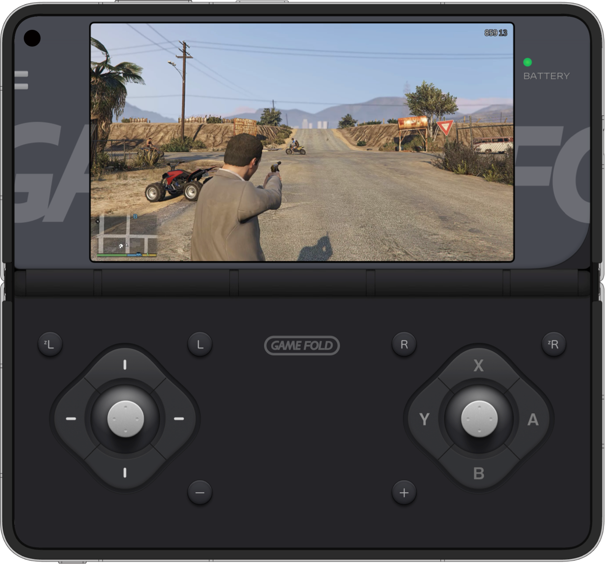

# GameFold PC

> **在折叠屏掌机上，本地启动你的 PC 游戏。**  
> Launch your PC games locally on a foldable handheld.

GameFold PC 折叠屏掌机游戏体验 · GameFold PC foldable handheld gameplay

<a href="https://gamefold.pages.dev">产品官网 / Official site</a> · <a href="https://github.com/lavande16/gamefold-pc-private/releases/tag/gamefold-pc-1.5-10180">下载 V1.5 / Download</a>

## 当前基线 · Current baseline

| 项目 | 信息 |
|---|---|
| 版本 | **GameFold PC V1.5 · versionCode 10180** |
| Android 包名 | **com.gamefold.pc** |
| 下载 | [GitHub Release：V1.5 / 10180](https://github.com/lavande16/gamefold-pc-private/releases/tag/gamefold-pc-1.5-10180) |
| 主要方向 | PC 游戏库、外接显示与双屏体验 |

## 把本地 PC 游戏带进掌机 · Your PC games, ready for handheld play

- **把 PC 游戏带在身边：**在 Android 掌机上整理并启动本地 PC 游戏，让通勤、旅途或零碎时间也能回到自己的游戏库。  
  **Take your PC games with you:** organize and launch local PC games on an Android handheld, so your library is ready for a commute, a trip or a spare moment.
- **自己的游戏库，管理与启动在一处：**从 GameFold PC 界面进入本地游戏入口、启动与设置流程，减少在不同工具之间来回切换。  
  **One place for your library:** access local game entries, launch actions and settings through GameFold PC, with less switching between tools.
- **从掌机切换到更大画面：**V1.5 保留外接显示与双屏控制入口；设备支持时，可从随身游玩延伸到更宽阔的显示空间。实际效果取决于设备和显示器。  
  **Move from handheld to a larger display:** V1.5 retains external-display and dual-screen controls. When supported, continue from portable play on a larger screen. Results depend on the device and display.
- **首次准备有清晰路径：**官网把流程拆成安装 GameFold PC、下载 PC 游戏资源、将完整资源文件夹放入手机根目录三步。游戏资源由使用者自行准备并确保有权使用。  
  **A clear first-time setup:** the website guides you through installing GameFold PC, getting PC game resources and placing the complete folder in the device root. Users provide their own game files and are responsible for having the right to use them.
- **作为普通应用运行：**当前 Release 是非调试构建，不依赖 root 运行模式。  
  **Runs as a regular app:** the current Release is a non-debuggable build and does not require root.

> 仓库保存 GameFold PC V1.5 的源码与基线资料。仓库不提供商业游戏文件；使用者需自行准备有权使用的游戏内容，实际兼容性因设备和游戏而异。  
> This repository preserves the GameFold PC V1.5 source and baseline materials. Commercial game files are not included; provide content you are entitled to use. Compatibility depends on the device and game.

## 继续开发 · Continue development

从 [baseline/](baseline/)、[源码快照说明](SOURCE_SNAPSHOT.md)、[路线图](ROADMAP.md) 与仓库中的双屏验证记录开始。版本下载与可用 APK 以 V1.5 Release 为准。  
Start with [baseline/](baseline/), the [source snapshot notes](SOURCE_SNAPSHOT.md), [roadmap](ROADMAP.md) and the dual-display evidence in this repository. The V1.5 Release is the source for the current APK.

## GameFold / GamePad 产品矩阵 · Product family

GameFold 面向折叠屏手机，GamePad 面向 Android 平板。  
GameFold is for foldable phones; GamePad is for Android tablets.

| 产品线 / Product | 仓库 / Repository | 官网 / Website | 描述 / Description |
|---|---|---|---|
| GameFold NS | [gamefold-ns-private](https://github.com/lavande16/gamefold-ns-private) | [GameFold](https://gamefold.pages.dev) | 在折叠屏手机上运行 Switch 游戏。 Run Switch games on a foldable phone. |
| GameFold PC | [gamefold-pc-private](https://github.com/lavande16/gamefold-pc-private) | [GameFold](https://gamefold.pages.dev) | 在折叠屏手机上运行 PC 游戏。 Run PC games on a foldable phone. |
| GameFold FC | [gamefold-fc-private](https://github.com/lavande16/gamefold-fc-private) | [GameFold FC](https://game-fold.pages.dev) | 在折叠屏手机上运行 FC 游戏。 Run FC games on a foldable phone. |
| GamePad NS | [gamepad-ns-private](https://github.com/lavande16/gamepad-ns-private) | [GameFold](https://gamefold.pages.dev) | 在 Android 平板上运行 Switch 游戏。 Run Switch games on an Android tablet. |
| GamePad PC | [gamepad-pc-private](https://github.com/lavande16/gamepad-pc-private) | [GameFold](https://gamefold.pages.dev) | 在 Android 平板上整理并启动本地 PC 游戏。 Organize and launch local PC games on an Android tablet. |
| GamePad PS | [gamepad-ps-private](https://github.com/lavande16/gamepad-ps-private) | [GameFold](https://gamefold.pages.dev) | 在 Android 平板上畅玩自己的 PS2 游戏库。 Play your PS2 library on an Android tablet. |

---

私有源码与基线备份 · Private source and baseline backup · 第三方品牌归各自权利人所有 · Third-party names belong to their respective owners

