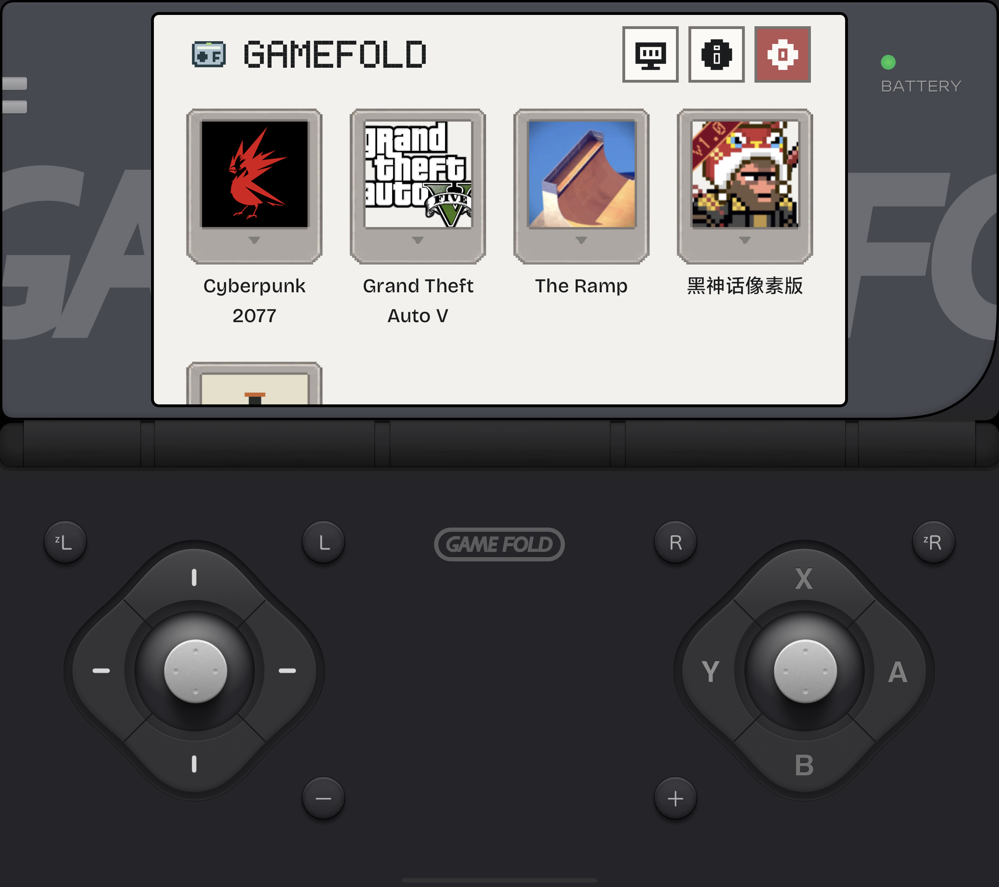

# GameFold PC

> **让 PC 游戏库在折叠屏掌机与外接大屏之间接得自然。**  
> Take your PC game library from a foldable handheld to a larger display.

GameFold PC 界面画面 · GameFold PC interface

<a href="https://gamefold.pages.dev">产品官网 / Official site</a> · <a href="https://github.com/lavande16/gamefold-pc-private/releases/tag/gamefold-pc-1.5-10180">下载 V1.5 / Download</a>

## 当前基线 · Current baseline

| 项目 | 信息 |
|---|---|
| 版本 | **GameFold PC V1.5 · versionCode 10180** |
| Android 包名 | **com.gamefold.pc** |
| 下载 | [GitHub Release：V1.5 / 10180](https://github.com/lavande16/gamefold-pc-private/releases/tag/gamefold-pc-1.5-10180) |
| 主要方向 | PC 游戏库、外接显示与双屏体验 |

## 给掌机与大屏之间的一座桥 · From handheld to big screen

- **从熟悉的游戏库开始：**整理本地 PC 游戏入口，让添加、启动与设置都在同一个 GameFold 界面里完成。  
  **Start from a familiar library:** keep local PC game entries, launch actions and settings together in one GameFold interface.
- **小屏与外接屏都能继续使用：**V1.5 保留外接显示与双屏控制入口，方便从移动游玩切换到更宽阔的画面。具体效果受设备和显示器支持影响。  
  **Keep playing on another display:** V1.5 retains external-display and dual-screen controls for a move from mobile play to a larger view. Behavior depends on device and display support.
- **下载与信息入口更清楚：**Quark 相关下载入口、About 信息和外接屏设置集中在产品体验里。  
  **Clearer setup paths:** Quark-related download access, About information and external-display controls are part of the product flow.
- **以普通应用方式运行：**当前 Release 使用非调试构建，不依赖 root 运行模式。  
  **Runs as a regular app:** the current Release is a non-debuggable build and does not rely on a root run mode.

> 仓库保存 GameFold PC V1.5 的源码与基线资料。仓库不提供商业游戏文件；使用者需自行准备有权使用的游戏内容，实际兼容性因设备和游戏而异。  
> This repository preserves the GameFold PC V1.5 source and baseline materials. Commercial game files are not included; provide content you are entitled to use. Compatibility depends on the device and game.

## 继续开发 · Continue development

从 [baseline/](baseline/)、[源码快照说明](SOURCE_SNAPSHOT.md)、[路线图](ROADMAP.md) 与仓库中的双屏验证记录开始。版本下载与可用 APK 以 V1.5 Release 为准。  
Start with [baseline/](baseline/), the [source snapshot notes](SOURCE_SNAPSHOT.md), [roadmap](ROADMAP.md) and the dual-display evidence in this repository. The V1.5 Release is the source for the current APK.

## GameFold 产品矩阵 · Product family

| 产品线 / Product | 仓库 / Repository | 官网 / Website |
|---|---|---|
| GameFold NS | [gamefold-ns-private](https://github.com/lavande16/gamefold-ns-private) | [GameFold](https://gamefold.pages.dev) |
| GamePad NS | [gamepad-ns-private](https://github.com/lavande16/gamepad-ns-private) | [GameFold](https://gamefold.pages.dev) |
| GameFold PC | [gamefold-pc-private](https://github.com/lavande16/gamefold-pc-private) | [GameFold](https://gamefold.pages.dev) |
| GamePad PC | [gamepad-pc-private](https://github.com/lavande16/gamepad-pc-private) | [GameFold](https://gamefold.pages.dev) |
| GameFold FC | [gamefold-fc-private](https://github.com/lavande16/gamefold-fc-private) | [GameFold FC](https://game-fold.pages.dev) |
| GamePad PS | [gamepad-ps-private](https://github.com/lavande16/gamepad-ps-private) | [GameFold](https://gamefold.pages.dev) |

---

私有源码与基线备份 · Private source and baseline backup · 第三方品牌归各自权利人所有 · Third-party names belong to their respective owners

